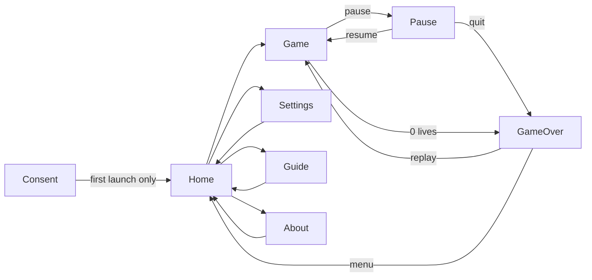

# PRD: Nightstalker

Status: approved
Project slug: nightstalker
Final app name: Nightstalker
Android package: io.github.nhilaire.nightstalker
Version target: 0.1.0
Last updated: 2026-10-20

> Written in English. Player-facing text is quoted in the "Player copy" section, in every language of the game
> (`factory-app.json` "languages"; French is the reference).
> Status becomes `approved` only after the user explicitly approves this document.

## Summary

Nightstalker is a landscape, two-thumb arcade maze shooter for Android, an original homage to Night Stalker
(Mattel, Intellivision, 1982). The player roams a single 20 x 12 hedge maze, picks up a 6-bullet gun, shoots an
escalating roster of robots, avoids a paralysing spider and bats, and shelters in a small bunker. The run is endless;
difficulty rises with the score. Fun comes from scarce ammunition, readable threats and the "one more run" of beating
the best score. An optional modern mode (on by default) adds 19 power-ups and combo bonuses.

This is a **faithful port** of the user's earlier Expo prototype `C:/dev/Nightstalker`: its **code** is the rules
reference (newer than its `SPECS.md`); every number below comes from that code. Deviations decided with the user are
marked **D1-D5**.

French pitch: « Survis dans le labyrinthe, compte tes balles, et tiens tête aux robots. »

## Target players

- Adults nostalgic for 80s arcade and Intellivision games; casual to core.
- Played two-handed, phone in landscape (commute, couch). Sessions of 5-15 min, endless runs.
- Accessibility: control side swap (left/right), four fire modes including one-button auto-aim; sound, ambience and
  vibrations can each be turned off.

## Core loop

1. Leave the bunker, run to the blinking gun and pick it up (6 bullets).
2. Hunt robots while avoiding enemy fire, the spider and the bats; ration bullets (one on screen at a time).
3. When the gun is empty, a new gun appears elsewhere: run for it, or hide in the bunker.
4. Score climbs, tougher robots replace weaker ones every tier; lose all lives → game over, try to beat the best score.

"One more run": the next tier robot is always close, and the best-score list is shown on the game over screen.

## Use cases

| ID | As a player I want to... | So that... |
|---|---|---|
| UC-01 | choose whether to share anonymous statistics at first launch, in my phone's language | my privacy is respected |
| UC-02 | start a run from the home screen and see my best score | I know what to beat |
| UC-03 | move with a joystick and shoot in four directions with the fire mode I prefer | the controls suit my thumbs |
| UC-04 | survive as long as possible as the enemies get tougher | the game stays tense |
| UC-05 | pick up power-ups and chain combos (modern mode) or play classic rules | I choose my kind of challenge |
| UC-06 | pause, resume or quit a run, and have the game pause itself when I leave the app | I never lose a run by accident |
| UC-07 | see my score, a new-best mention and my top scores at game over, then replay | I want one more run |
| UC-08 | change controls side, fire mode, modern mode, sound, ambience, vibrations, language and statistics | I control the experience |
| UC-09 | read what each power-up does | I can use them well |
| UC-10 | read why this game exists and who made it | I know the story behind it |

## Screens



All screens are landscape, full screen (status and navigation bars hidden, swipe to reveal), dark background.

- **Consent** (first launch only): factory consent screen in the current language; « Accepter » and « Refuser » have
  equal weight; the choice can be changed in Settings.
- **Home:** title `home.title`, tagline `home.tagline`, primary button `home.play`; secondary buttons
  `home.settings`, `home.guide`, `home.about`; best score (`home.bestScore`, 6 digits, `000000` when none); a controls
  hint showing which side moves and which side fires, following the "swap controls" setting (**D3**); footer
  `home.footer`.
- **Game:** the maze, scaled to fit the screen and centred; HUD left column: lives (player icons + `×N`), active
  power-up chips (label, remaining charges `×N`), combo multiplier (`game.combo`), bonus flash
  (label + `+points` when the bonus gave points); HUD right column: score (6 digits), `+1 VIE` flash on a life bonus,
  best score (`game.best`), ammo row (`game.ammo` with 6 pips, or `game.noGun` in red-flash when firing without
  ammo); pause button `‖‖`. Joystick zone on one half of the screen, fire zone on the other (swappable).
- **Pause overlay:** `pause.title`, buttons `pause.resume` and `pause.quit`.
- **Game over:** `gameover.title`, final score (6 digits), `gameover.newBest` when the run beat the previous best,
  `gameover.topScores` with the 5 best scores (rank + 6 digits), buttons `gameover.replay` and `gameover.menu`.
- **Settings:** swap controls (`settings.swap` + hint), fire mode (4 choices + hint of the selected one), modern mode
  (+ hint), sound effects, ambience, vibrations, statistics (telemetry), language (`settings.languageAuto` + one entry
  per language named in itself), back. Every change is saved immediately.
- **Guide (power-ups):** `guide.title`, lead text, the 19 power-ups in 6 groups: Tempo (slowMo, freeze, cloak,
  rapidFire), Offensive (piercing, spread, heavy, boomerang), Defensive (shield, bunkerRepair, phaseWalk, decoy),
  Economy (scoreX2, ammo, magnet, extraLife), Information (emp, xray), Mystery (mystery); each with its chip (icon, label, colour), description and duration/charges; back.
- **About:** story (`about.story`), how to play (`about.howTo`), inspiration (`about.inspiration`), word from the
  author, your data, version, back.

## Rules and scoring

All distances are in logical units; the playfield is 200 x 120 units, `TILE` = 10, grid 20 columns x 12 rows. The
game loop runs on `requestAnimationFrame` with `dt` capped at 0.05 s; nothing advances while paused.

### Maze

Layout (row 0 at top; `#` wall, `.` corridor, `W` web, `G` pen gate):

```
####################  00
#WWW#..............#  01
#WWW#.####.##.#.##.#  02
#.#.#.......#.#....#  03
#.#.#.#.....#.###.##  04
#.#...#.....#......#  05
#.#.#.#.......####.#  06
#.#.#.#.#####.#....#  07
#...#.......#...##.#  08
###.#.#####.#.####.#  09
#.G................#  10
####################  11
```

- The outer border is always wall.
- **Bunker:** columns 8-10, rows 4-5. Its cells are carved to corridor, the cell above the door (9, 3) is carved to
  corridor, then 5 destructible **segments** with 3 HP each are placed at (8, 4), (10, 4), (8, 5), (9, 5), (10, 5).
  The door cell (9, 4) is the only free bunker cell and the player's spawn point (x 95, y 45). "Inside the bunker"
  means `x/10` in (8.5, 10.5) and `y/10` in (3.5, 5.5). A segment with HP > 0 blocks the player, enemies and bullets.
- **Web:** `W` cells (columns 1-3, rows 1-2). The player moves at half speed there.
- **Pen:** cell (1, 10); gate `G` at (2, 10). Robots pass the gate; the player, bats and spider cannot.
- **Gun spots:** (5, 3), (18, 1), (18, 5), (5, 8), (18, 10).

### Player

- Starts at the spawn point with 6 lives, no gun, 1.2 s of invulnerability; next life bonus at 10,000.
- Radius 3.5. Speed 30 units/s, 15 in a web cell (and halved again by the "slow" curse).
- **Grid movement:** the joystick output becomes one cardinal direction (dominant axis, dead zone 0.25 of the stick
  radius). Releasing the stick stops the player at once (perpendicular axis snapped to the lane). Reversing on the
  same axis is instant; a perpendicular turn happens only at a cell centre (tolerance 1.2) and only if the next cell
  can be entered; starting from a stop only needs lane alignment. The player stops at a centre when the next cell is
  blocked. Cells that cannot be entered: walls, the gate, standing bunker segments, outside the grid.
- **Paralysis:** touching the spider or a bat outside the bunker freezes the player for 1.0 s (no move, no fire);
  a new contact re-arms the timer. A paralysed player can still be killed by enemy bullets.
- **Death:** an enemy bullet touching the player (alive or paralysed, not invulnerable, outside the bunker), or a
  robot touching an alive, non-invulnerable player outside the bunker. Then (unless a shield charge absorbs it, see
  power-ups): −1 life, gun and ammo lost, every player bullet removed, a gun is placed if none is on the map, the
  player disappears for 0.8 s, then reappears at the spawn point with 1.2 s of invulnerability (blinking).
- **Game over:** when lives reach 0 and the 0.8 s respawn delay has elapsed.

### Gun and player bullets

- At run start a gun is placed. Placement: among the 5 gun spots minus the current one, the one farthest from the
  player. The gun blinks.
- Touching the gun (radius 4) gives 6 bullets and removes the gun from the map.
- Firing: if the player has no gun or 0 ammo, nothing is fired and the ammo display flashes red (0.3 s). Otherwise,
  if no player bullet is on screen (or rapid fire is active), one bullet (or a volley, see spread) is fired, ammo −1;
  when ammo reaches 0 the player loses the gun and a new gun is placed (gun-spawn cue).
- Fire direction by mode: quadrants and d-pad give the tapped cardinal direction; auto-aim gives the dominant axis
  towards the nearest active (not spawning) enemy, or the last move direction if there is none; point-and-shoot gives
  the dominant axis of the vector from the player to the tap. Firing also sets the last move direction.
- Player bullet: radius 1.5, speed 90 units/s, lifetime 6 s, moved in sub-steps of at most 1.5 units. It stops on
  walls, bunker segments (no damage) and the field edge. It **passes through** enemies, damaging each enemy at most
  once. When the hit enemy stands in a web cell, the hit has a 50 % chance to be absorbed by the web (spark only).

### Enemies

| Type | HP | Speed | Fire cooldown (s) | Points | Behaviour |
|---|---|---|---|---|---|
| spider | 1 | 7 | - | 100 | roams around the web (anchor x 20, y 15, leash 80 units, then heads home); paralyses |
| bat | 1 | 15 | - | 300 | random patrol; paralyses |
| gray | 1 | 22 | 2.2 | 200 | random patrol, shoots |
| blue | 1 | 26 | 1.8 | 500 | random patrol, shoots |
| white | 3 | 26 | 1.6 | 1,000 | random patrol, shoots, reactive shield |
| black1 | 3 | 23 | 1.4 | 2,000 | tracks the player, shoots, reactive shield |
| black2 | 3 | 23 | 1.2 | 2,000 | tracks, shoots yellow bolts that damage the bunker, reactive shield |
| invisible | 3 | 24 | 1.0 | 4,000 | tracks, shoots lasers (**D4**), sprite at 25 % opacity, wide line of sight, reactive shield |

- Enemy radius 4. A new enemy blinks for 1.2 s ("spawning"): it neither moves, shoots, collides nor takes damage.
- **Reactive shield:** a non-lethal hit on white, black1, black2 or invisible raises a 2 s shield (blinking yellow
  halo): non-piercing player bullets and enemy bullets do nothing to it during that time.
- **Movement:** enemies move along lanes and choose a direction only at a cell centre (tolerance 1.5) after entering a
  new cell, and only if a perpendicular cell is enterable; in a dead end they turn back; when they bump into something
  between centres they snap to the centre and reverse. Enemies never enter the bunker. Robots pass the gate.
  - Patrol: random among enterable directions, weights forward 1.6, perpendicular 1.0, reverse 0.18.
  - Tracking (black1, black2, invisible): the axis with the largest distance to the player first, then the other,
    avoiding reverse when possible. Falls back to patrol while cloak is active or while unstuck mode runs.
  - Stuck detection: every 2 s, an enemy that moved ≤ 5 units patrols randomly for 2.5 s.
- **Enemy fire:** only robots shoot; at most **one enemy bullet** on screen for all enemies. A robot's cooldown only
  counts down while no enemy bullet exists. When it reaches 0: if the target (player, or decoy when active) is aligned
  on an axis within 6 units (14 for invisible) and cloak is off, it fires in that direction and the cooldown becomes
  base + random(0-0.6) s; otherwise it retries after random(0.3-0.7) s. Initial cooldown random(1-2.5) s. Walls do
  not block the decision (the bullet stops on them). Robots keep moving while shooting.
- Enemy bullet: speed 45, radius 1.5, lifetime 6 s. On a wall, bunker segment, decoy or the field edge it disappears
  and its shooter's cooldown is reset to 0. A yellow bolt (black2) removes 1 HP from the bunker segment it hits.
  The invisible robot's bullets are drawn as lasers (elongated light red) (**D4**, visual only).
- **Friendly fire:** an enemy bullet passing through another enemy damages it once (shield rules apply). An enemy
  killed this way gives **no points and no combo** (**D2**), but every roster rule below applies.

### Roster and tiers

The wanted roster depends on the score:

| Tier | Score | Roster | Main robot |
|---|---|---|---|
| 0 | < 5,000 | spider, 2 bats, 1 gray | gray |
| 1 | 5,000-14,999 | spider, 2 bats, 1 blue | blue |
| 2 | 15,000-29,999 | spider, 2 grays, 1 white | white |
| 3 | 30,000-49,999 | spider, 2 grays, 1 black1 | black1 |
| 4 | 50,000-79,999 | spider, 2 grays, 1 black2 | black2 |
| 5 | ≥ 80,000 | spider, 2 grays, 1 invisible | invisible |

Every frame, missing enemies are spawned and extra ones removed, with these rules:

- **Main carry-over:** the active main robot changes only when the current main is killed; it then becomes the main of
  the current score tier. Until then the old main keeps the main slot and the new tier's main is not spawned.
- **Bat conversion (tier 1):** each bat killed while the score is ≥ 5,000 (at most 2 per run) disappears for good and
  turns its slot into a gray; in tier 1 the wanted bats are 2 − conversions and the wanted grays equal the
  conversions (so the tier-0 gray leaves when tier 1 starts).
- **Spawn positions:** spider on a free web-area cell among (1..3, 1), (1..3, 2), (1, 3), (3, 3); first bat at one of
  (18, 1), (17, 1), (18, 3), (15, 3), second at one of (18, 10), (15, 10), (10, 10), (18, 6); robots at the pen centre.
- **Heartbeat tempo** (ambience loop period) per active main: gray 1.8 s, blue 1.65, white 1.5, black1 1.35,
  black2 1.2, invisible 1.05; it changes when the main changes.

### Scoring

- A player-bullet kill gives the enemy's points × combo multiplier (modern mode) × score multiplier (score ×2
  power-up), rounded.
- Every 10,000 points the player gains a life (several at once if a single gain crosses several thresholds).
- The best score is the first of the saved list (0 when the list is empty); the run is flagged "new best" as soon
  as its score is strictly greater than it (a 0-score run or a tie is never a new best).

### Modern mode (on by default; off = classic rules: no power-ups, no combos, no bonuses)

**Combos** (player-bullet kills only): each kill within 4 s of the previous one extends the streak; streak 1 → ×1,
2 → ×1.5, 3-4 → ×2, 5+ → ×3; the streak resets 4 s after the last kill.

**Bonuses** (points, multiplied by score ×2 when active; shown 2.5 s as a flash):

| Bonus | Condition | Points |
|---|---|---|
| Double kill | 2nd kill by the same bullet | 250 |
| Triple kill | 3rd kill by the same bullet | 750 |
| Mega kill | 4th+ kill by the same bullet | 1,500 |
| Quick draw | black1/black2/invisible killed < 1.5 s after it stopped spawning | 500 |
| Clutch | first kill by a bullet of the volley that emptied the gun; once per clip (**D5**) | 1,000 |
| Full clip | picking up a gun from the map when shots ≥ 4 and hits = shots (see below) | 1,000 |
| No-bunker run | reaching a new tier without having been inside the bunker since the previous tier (see below) | 2,000 |

- Full clip counting: "shots" counts fire presses that fired (a spread volley counts 1); "hits" counts damaging
  player-bullet hits on enemies (a bullet passing through 2 enemies counts 2; hits blocked by a shield or absorbed by
  the web count 0). Both counters reset to 0 whenever a gun is picked up from the map; the ammo power-up neither
  checks nor resets them.
- No-bunker run: the "entered the bunker" flag is set every frame the player is inside the bunker and cleared when a
  new tier is reached. The player spawns and respawns inside the bunker, so the tier 1 bonus can never be earned and a
  death cancels the bonus of the current tier. A gain that crosses several tiers gives one bonus.
- Clutch (**D5**, the prototype gave it for any kill while the gun was empty): granted at most once per clip, on the
  first kill made by a bullet fired by the shot that brought ammo to 0.

**Power-ups:** the first appears 18 s into the run, then every random 22-38 s, only when none is on the map. It sits
on a free corridor cell (not a wall, the bunker, a standing segment, the gun or another power-up, ≥ 70 units from the
player), lasts 12 s and blinks during its last 4 s. Touching it (radius 5) applies it and shows its label (without
points, **D3**). The kind is drawn with these weights:

| Kind | Weight | Effect |
|---|---|---|
| slowMo | 3 | enemies at half speed for 25 s |
| freeze | 1 | enemies frozen (no move, no fire countdown) for 4 s |
| cloak | 2 | robots lose sight of the player (no tracking, no firing decision) for 8 s |
| rapidFire | 3 | no one-bullet limit for 6 s |
| piercing | 2 | next shot ignores reactive shields (1 charge) |
| spread | 2 | next shot fires 3 bullets: the direction and both perpendiculars (1 charge) |
| heavy | 1 | next 3 shots kill any enemy in one hit (3 charges) |
| boomerang | 1 | next shot bounces back once on a wall (1 charge) |
| shield | 2 | absorbs the next death: no life lost, 1.5 s invulnerability (1 charge) |
| bunkerRepair | 1 | every bunker segment back to 3 HP |
| phaseWalk | 1 | player walks through walls and the gate (not bunker segments) for 4 s |
| decoy | 1 | a decoy at the pickup spot draws robots' aim and stops enemy bullets for 8 s |
| scoreX2 | 3 | all points ×2 for 30 s |
| ammo | 3 | gun in hand with 6 bullets (the gun on the map is removed) |
| magnet | 1 | the gun moves to a free cell within 4 cells of the player (3rd closest) |
| extraLife | 0.5 | +1 life |
| emp | 2 | removes enemy bullets; every robot waits ≥ 3 s before firing |
| xray | 2 | invisible robots shown clearly and robots' lines of sight drawn for 12 s |
| mystery | 2 | if score < 5,000 or lives < 2: a random buff; otherwise 50 % a random buff, 50 % a curse |

Mystery buffs: slowMo, rapidFire, shield, scoreX2, ammo, extraLife, emp, xray, spread, heavy, piercing,
bunkerRepair (uniform). Curses (uniform): "slow" (player speed halved for 10 s), "no ammo" (gun and ammo lost, a gun
is placed if none), "volley" (every robot's cooldown set to 0). Charges stack; durations restart when picked again.

### Persistence

- Scores: the 10 best runs (score + date) sorted by score descending (stable: equal scores keep their insertion
  order), every run saved even with 0 points, saved locally at every game over, including a
  run quit from the pause menu. Home shows the best; game over shows the 5 best.
- Settings (swap controls off, fire mode quadrants, modern on, sound on, ambience on, vibrations on), language
  (automatic) and telemetry consent are saved locally and survive restarts. A change to modern mode applies to the
  next run.

### Pause and debug cheats

- The pause button pauses the run; leaving the app (background) pauses it automatically; the ambience pauses too.
- Debug cheats (3 quick taps in the top-right corner: +2 lives and full gun; top-left: +5,000 points) exist only in
  debug and test builds; **release builds contain no cheat zone**.

## Look, sound and feel

- Original pixel-art sprites (8 x 8 / 12 x 12 logical pixels) drawn with Skia: pale yellow player, yellow spider,
  dark bats, grey/blue/white/black robots, near-invisible robot. Dark blue maze floor `#1E40AF`, near-black hedges,
  light bunker, dark web with pale strands, neon accents. No asset, sprite or sound from the original game.
- Square particles for hits and explosions; a much bigger multicolour burst with a ring when the invisible robot dies;
  blinking for spawning enemies, invulnerability, the gun and expiring power-ups; yellow halo for shields.
- Sound (all synthesised at run time, no audio file): effects for gun appearing, power-up appearing, explosions
  (kill, death) and shield bounce; ambience = looping heartbeat whose tempo rises with the main robot (D1: three
  switches: sound effects, ambience, vibrations).
- Haptics: light on shoot/hit, medium on kill and bunker damage, heavy on death, success on pickup and life bonus,
  warning on paralysis, double tap when a power-up appears.
- Landscape locked, full screen.

## Telemetry events

Only events listed here may be sent, after consent. Params: numbers or short lowercase enums. No identifiers.

| Event | When | Params | Feeds KPI |
|---|---|---|---|
| game_start | a run starts (play or replay) | modern (`on`/`off`), fire_mode (`quadrants`/`dpad`/`autoaim`/`point`), controls (`normal`/`swapped`) | Runs per session, Settings adoption |
| tier_reached | the score enters tier 1-5 for the first time in the run; a gain crossing several tiers sends one event per tier, in order | tier (1-5), duration_s | Tier funnel |
| powerup_pickup | a power-up is picked up | kind (snake_case of the kind, e.g. `slow_mo`) | Power-up usage |
| game_over | a run ends | score, tier (0-5), duration_s, modern (`on`/`off`), reason (`lives`/`quit`) | Score distribution, Tier funnel, Run length |
| settings_change | a setting changes in Settings (telemetry: only when turned on) | setting (`swap`/`fire_mode`/`modern`/`sound`/`ambience`/`haptics`/`language`/`telemetry`), value (`on`/`off`/`quadrants`/`dpad`/`autoaim`/`point`/`auto`/`fr`/`en`) | Settings adoption |

## KPIs

Business and technical indicators followed in Firebase (free Spark plan). Details and console paths in `docs/KPIS.md`.

| KPI | Type | Target | Source |
|---|---|---|---|
| D1 retention | business | ≥ 25 % | Analytics > Retention |
| D7 retention | business | ≥ 8 % | Analytics > Retention |
| Runs per session | business | ≥ 2 | `game_start` count / `session_start` count |
| Tier funnel | business | ≥ 50 % of runs reach tier 1 | `tier_reached` by `tier` vs `game_start` |
| Score distribution | business | (observe, to tune difficulty) | `game_over` metric `score` |
| Run length | business | median ≥ 3 min (observe) | `game_over` metric `duration_s` |
| Settings adoption | business | (observe) | `game_start` by `fire_mode`, `modern`, `controls`; `settings_change` |
| Power-up usage | business | (observe) | `powerup_pickup` by `kind` |
| Crash-free users | technical | ≥ 99 % | Crashlytics |
| ANR rate | technical | < 0.5 % | Crashlytics (ANR filter) |

## Non-functional requirements

- Performance: smooth on a mid-range Android phone (no visible jank during play), cold start < 3 s.
- APK size (arm64): target < 40 MB.
- Works fully offline. No account. No ads. No backend.
- Android only, landscape locked, full screen; minSdk from the stack defaults.
- Privacy: opt-in telemetry, no personal data, AD_ID permission removed.
- Nothing is copied from the source folder except game code and art assets (never `deploy.bat`, `deploy/`,
  `build-*.bat`, `android/`, `dist/`, `.expo/`, `.github/`).

## Acceptance criteria

Each criterion is testable and tagged with its proof: `[unit]` Jest, `[e2e]` Maestro flow, `[device]` check on the
phone, `[manual]` human judgement. Game-logic tests drive the pure engine with fixed `dt` and an injectable random
source.

Platform, language, privacy

- AC-01 [e2e] Given a first launch, when the app opens, then the consent screen is shown in the phone's language
  (fallback English if unsupported) with « Accepter » and « Refuser » of equal size; after either choice Home is
  shown, and the consent screen is not shown at the next launch.
- AC-02 [unit] Given a phone in French / in English / in an unsupported language (e.g. Italian), then the UI is in
  French / English / English.
- AC-03 [e2e] Given Settings, when the player picks another language, then the whole UI switches at once and the
  choice survives a restart; « Automatique » follows the phone again.
- AC-04 [device] The name under the icon is "Nightstalker" whatever the phone's language.
- AC-05 [unit] Given telemetry consent refused, unset, or turned off in Settings, when any game event happens, then
  nothing is sent; given consent, then only the events and params of the "Telemetry events" table are sent, with the
  values listed there; a score gain crossing tiers 1 and 2 at once sends `tier_reached` 1 then 2.
- AC-06 [e2e] Given consent accepted, when a run is started and quit, then `game_start` and `game_over` appear in
  logcat (`verify.mjs --telemetry`).
- AC-07 [unit] Given `src/i18n/fr.ts` and `en.ts`, then they have the same keys, no empty text, French uses tu and
  French typography (no-break space before `: ; ! ?`), the combo multiplier is shown `×1,5` in French and `×1.5` in
  English, and the UI strings match the "Player copy" tables.

Maze, movement, gun

- AC-08 [unit] Given the maze, then it is 20 x 12 with a wall border, the layout of this PRD, 5 bunker segments of
  3 HP at the listed cells, (9, 3) and (9, 4) passable, and the spawn point (95, 45) is inside the bunker.
- AC-09 [unit] Given the player in a straight corridor with the stick held east, when 1 s passes, then x grows by 30
  (15 in a web cell); when the stick is released, then the player stops at once; when the stick goes west, then the
  player reverses at once; a perpendicular input is applied only at a cell centre whose next cell is enterable.
- AC-10 [unit] Given the player next to a wall, the gate, or a standing bunker segment, when moving into it, then the
  player stops at the cell centre.
- AC-11 [unit] Given a run start, then a gun is on one of the 5 spots; when a gun is placed again, then it is never
  the current spot and is the farthest remaining spot from the player.
- AC-12 [unit] Given the player touches the gun, then ammo = 6; when 6 shots are fired, then ammo reaches 0, the
  player has no gun and a new gun is placed; given no gun, when fire is pressed, then no bullet is fired and the
  no-ammo flash is set.
- AC-13 [unit] Given a player bullet on screen and no rapid fire, when fire is pressed, then no second bullet is
  fired; the bullet moves 90 units/s, passes through two aligned enemies hitting each once, and stops on a wall and
  on a bunker segment without damaging it.
- AC-14 [unit] Given each fire mode, then the shot direction is: the tapped direction (quadrants, d-pad); the
  dominant axis towards the nearest active enemy, or the last move direction if none (auto-aim); the dominant axis
  from the player to the tap (point-and-shoot).
- AC-15 [unit] Given an enemy in a web cell and a random source returning < 0.5, when a player bullet reaches it,
  then no damage is done; with ≥ 0.5, then it takes 1 damage.

Enemies

- AC-16 [unit] Given each enemy type, then HP, speed, fire cooldown and points match the enemy table; a newly
  spawned enemy does not move, shoot, collide or take damage for 1.2 s.
- AC-17 [unit] Given a white, black1, black2 or invisible robot hit once, then its shield is up for 2 s, a normal
  player bullet does nothing to it, a piercing bullet damages it, and after 2 s a normal bullet damages it again.
- AC-18 [unit] Given two robots ready to fire and aligned with the player, then only one enemy bullet exists at a
  time; a robot not aligned (beyond 6 units, 14 for invisible) does not fire; spiders and bats never fire; when an
  enemy bullet hits a wall, then its shooter's cooldown is 0.
- AC-19 [unit] Given a black2 bolt hitting a bunker segment, then the segment loses 1 HP; at 0 HP the cell becomes
  passable; a normal enemy bullet does not damage segments; an invisible robot's bullet has the laser variant.
- AC-20 [unit] Given an enemy bullet passing through another enemy, then that enemy takes 1 damage (none if shielded);
  if it dies, then the score and combo do not change (D2) and the roster rules still apply.
- AC-21 [unit] Given an enemy at a cell centre with no perpendicular option, then it keeps its direction (or turns
  back in a dead end); given a tracking robot at a crossing, then it takes the axis of the largest distance to the
  player; given an enemy that moved ≤ 5 units in 2 s, then it patrols randomly for 2.5 s; no enemy ever enters the
  bunker; bats and spider never cross the gate, robots do.

Player hits, lives, end

- AC-22 [unit] Given the player outside the bunker and not invulnerable, when an enemy bullet or a robot touches
  them, then one life is lost, the gun and player bullets are removed, a gun is on the map, and after 0.8 s the player
  is at the spawn point with 1.2 s of invulnerability; inside the bunker or while invulnerable nothing happens.
- AC-23 [unit] Given the spider or a bat touching the player outside the bunker, then the player is paralysed 1.0 s
  (no move, no fire), a new contact re-arms it, and an enemy bullet still kills a paralysed player.
- AC-24 [unit] Given 1 life left, when the player dies, then the game is over 0.8 s later.

Roster, scoring, modern mode

- AC-25 [unit] Given scores 0, 5,000, 15,000, 30,000, 50,000 and 80,000 with the matching main robot, then the
  roster is the one of the tier table; given a tier crossed while the old main is alive, then the new main is not
  spawned until the old one is killed.
- AC-26 [unit] Given score ≥ 5,000, when bats are killed, then each of the first 2 disappears for good and a gray
  spawns at the pen; killing that gray respawns a gray, never a bat.
- AC-27 [unit] Given spawning, then the spider appears on a listed web-area cell, the first bat in the top-right
  pool, the second in the south-east pool, and robots at the pen.
- AC-28 [unit] Given classic mode, when each enemy type is killed by a player bullet, then the score grows by its
  points; when the score crosses 10,000 and 20,000 in one gain, then 2 lives are added; the "new best" flag is set
  when the score passes the saved best, never for a 0-score run or a tie, and a first
  run scoring > 0 with an empty list is a new best.
- AC-29 [unit] Given modern mode, when kills follow each other within 4 s, then the multipliers are 1, 1.5, 2, 2, 3;
  after 4 s without a kill, then the next kill is ×1; in classic mode there is no multiplier.
- AC-30 [unit] Given modern mode, then each bonus of the bonus table is granted exactly under its condition with its
  points, and scoreX2 doubles kill points and bonuses for 30 s. Cases: full clip with 4 shots / 4 hits (granted),
  4 shots / 3 hits (not), a spread volley counted as 1 shot; no-bunker run never granted for tier 1, granted for tier
  2 when the player stayed out of the bunker since tier 1, cancelled by a death, granted once when one gain crosses
  two tiers; clutch granted once when the last bullet kills 2 enemies and not for another bullet in flight (D5).
- AC-31 [unit] Given modern mode, then the first power-up appears at 18 s, the next ones 22-38 s apart and only when
  none is on the map, on a valid cell ≥ 70 units from the player, and it vanishes after 12 s; in classic mode none
  appears.
- AC-32 [unit] Given each of the 19 power-ups picked up, then its effect matches the power-up table (durations,
  charges, stacking), and the HUD flash shows its label with no points (D3).
- AC-33 [unit] Given a mystery pickup with score < 5,000 or lives < 2, then a buff is always applied; otherwise,
  with a random source, each of the 3 curses and a buff can be produced with their effects.
- AC-34 [unit] Given the heartbeat, when the active main changes, then the tempo matches the tempo table.

Screens, settings, persistence

- AC-35 [e2e] Given Home, when « Jouer » is tapped, then the game shows 6 lives, score 000000 and « PAS D'ARME »;
  when pause then « Quitter » are tapped, then game over shows the score and the top scores; « Rejouer » starts a new
  run and « Menu » goes back to Home.
- AC-36 [unit] Given 12 finished runs, then the saved list keeps the 10 best in descending order, equal scores in insertion
  order, 0-score runs included; a run quit from the pause menu is saved too.
- AC-37 [unit] Given a finished run saved by the game over screen, when the app is restarted, then Home shows that
  score as the best score. (Amended 2026-10-27 with the user: release builds have no cheat, so an e2e run cannot score
  reliably; the e2e flow `scores-persist.yaml` complements it by showing that saved runs survive a restart.)
- AC-38 [e2e] Given Settings, when swap controls, fire mode, modern mode, sound effects, ambience and vibrations are
  changed, then the values survive a restart.
- AC-39 [e2e] Given swap controls on, then in a run the joystick is on the right and the fire zone on the left, and
  the Home controls hint says move on the right and fire on the left (D3); off gives the opposite.
- AC-40 [unit] Given sound effects off, then no effect is played; given ambience off, then the heartbeat does not
  play; given vibrations off, then no haptic is triggered (D1); each on restores its output.
- AC-41 [unit] Given a release build configuration, then the game screen renders no cheat zone and cheats cannot be
  triggered; given a debug build, then the 3-tap cheats work.
- AC-42 [device] Given a run in progress, when the app goes to the background and comes back, then the pause overlay
  is shown and the ambience is paused; « Reprendre » resumes.
- AC-43 [e2e] Given Home, when « Guide » is tapped, then the 19 power-ups are listed in 6 groups with label,
  description and duration or charges.
- AC-44 [e2e] Given Home, when « À propos » is tapped, then the story `about.story` is shown verbatim, with how to
  play, the inspiration notice, the word from the author, your data and the version, in the current language.

Quality on the phone

- AC-45 [device] Given a release build on the user's phone, cold start is < 3 s and no crash or ANR appears in logcat
  during the Maestro flows.
- AC-46 [device] Given a release build on the user's phone, when a run with 4 enemies, particles and a power-up is
  played for 60 s, then frame statistics show no visible jank (≥ 55 fps on average).
- AC-47 [device] Given sound on, when playing, then the effects and the heartbeat are audible, and the heartbeat
  speeds up when the main robot changes; vibrations are felt on shoot, kill and death.
- AC-48 [manual] Given the phone, the controls feel responsive and the game keeps the tense arcade feel of the
  prototype.

## Player copy

French uses tu. Final app name: fr "Nightstalker", en "Nightstalker". Language-specific assets: none (no image with
text, no spoken audio; all text is drawn by the UI). Numbers in the score, best and top lists are 6-digit padded
(`000000`). `{n}` in `game.combo` is formatted for the language (fr `1,5`, en `1.5`). Consent, error and generic factory strings come from the factory template, adapted to tu.

| Key | fr | en |
|---|---|---|
| consent.title | Ta vie privée | Your privacy |
| consent.body | J'aimerais mesurer de façon anonyme l'utilisation du jeu et détecter les plantages pour l'améliorer. Aucune donnée personnelle n'est collectée et rien n'est utilisé à des fins publicitaires. | I would like to measure how the game is used, anonymously, and detect crashes to improve it. No personal data is collected and nothing is used for advertising. |
| consent.accept | Accepter | Accept |
| consent.refuse | Refuser | Decline |
| consent.footnote | Tu pourras changer d'avis à tout moment dans les paramètres. | You can change your mind at any time in the settings. |
| home.title | NIGHTSTALKER | NIGHTSTALKER |
| home.tagline | Survis dans le labyrinthe. Compte tes balles. | Survive the maze. Count your bullets. |
| home.play | Jouer | Play |
| home.settings | Paramètres | Settings |
| home.guide | Guide | Guide |
| home.about | À propos | About |
| home.bestScore | Meilleur score | Best score |
| home.hintMove | Déplacement | Move |
| home.hintFire | Tir | Fire |
| home.hintLeft / home.hintRight | ← Gauche / Droite → | ← Left / Right → |
| home.footer | Un hommage aux jeux de tir en labyrinthe du début des années 80 | A tribute to the maze shooters of the early 80s |
| game.lives | VIES | LIVES |
| game.best | MEILLEUR | BEST |
| game.ammo | BALLES | AMMO |
| game.noGun | PAS D'ARME | NO GUN |
| game.lifeBonus | +1 VIE | +1 LIFE |
| game.combo | COMBO ×{n} | COMBO ×{n} |
| game.pause | Pause | Pause |
| pause.title | PAUSE | PAUSED |
| pause.resume | Reprendre | Resume |
| pause.quit | Quitter | Quit |
| gameover.title | PARTIE TERMINÉE | GAME OVER |
| gameover.newBest | NOUVEAU RECORD ! | NEW HIGH SCORE! |
| gameover.topScores | MEILLEURS SCORES | TOP SCORES |
| gameover.replay | Rejouer | Replay |
| gameover.menu | Menu | Menu |
| bonus.doubleKill | DOUBLÉ | DOUBLE KILL |
| bonus.tripleKill | TRIPLÉ | TRIPLE KILL |
| bonus.megaKill | MÉGA | MEGA KILL |
| bonus.quickDraw | DÉGAINE ÉCLAIR | QUICK DRAW |
| bonus.clutch | DERNIÈRE BALLE | CLUTCH |
| bonus.fullClip | SANS FAUTE | FULL CLIP |
| bonus.noBunker | SANS BUNKER | NO-BUNKER RUN |
| bonus.shieldAbsorb | BOUCLIER ! | SHIELD ABSORB |
| curse.slow | MAUDIT : LENT | CURSED: SLOW |
| curse.noAmmo | MAUDIT : PLUS DE BALLES | CURSED: NO AMMO |
| curse.volley | MAUDIT : SALVE | CURSED: VOLLEY |
| settings.title | Paramètres | Settings |
| settings.swap | Inverser les commandes | Swap controls |
| settings.swapOff | Joystick : GAUCHE · Tir : DROITE | Joystick: LEFT · Fire: RIGHT |
| settings.swapOn | Joystick : DROITE · Tir : GAUCHE | Joystick: RIGHT · Fire: LEFT |
| settings.fireMode | Mode de tir | Fire mode |
| settings.fire.quadrants / hint | QUADRANTS / Touche un quart du cercle de tir pour tirer vers le haut, le bas, la gauche ou la droite | QUADRANTS / Tap a quarter of the fire circle to shoot up, down, left or right |
| settings.fire.dpad / hint | CROIX / Quatre boutons en croix, un par direction | D-PAD / Four buttons in a cross, one per direction |
| settings.fire.autoaim / hint | VISÉE AUTO / Un seul bouton : le tir vise l'ennemi le plus proche | AUTO-AIM / One button: the shot targets the nearest enemy |
| settings.fire.point / hint | POINTER-TIRER / Touche n'importe où de ce côté : la balle part vers ton doigt | POINT & SHOOT / Tap anywhere on that side: the bullet flies toward your finger |
| settings.modern / On / Off | Mode moderne / Power-ups, combos et multiplicateurs actifs / Mode classique : règles de base uniquement | Modern mode / Power-ups, combos and multipliers on / Classic mode: base rules only |
| settings.modernNext | S'applique à la prochaine partie. | Applies to the next run. |
| settings.sound / hint | Bruitages / Explosions, arme, power-ups | Sound effects / Explosions, gun, power-ups |
| settings.ambience / hint | Ambiance / Battement de cœur qui accélère avec la difficulté | Ambience / Heartbeat that speeds up with the difficulty |
| settings.haptics / hint | Vibrations / Au tir, aux impacts et à la mort | Vibrations / On shots, hits and death |
| settings.telemetry | Partager des statistiques anonymes | Share anonymous statistics |
| settings.telemetryHelp | Aide à corriger les bugs et à améliorer le jeu. Aucune donnée personnelle n'est envoyée. | Helps fix bugs and improve the game. No personal data is sent. |
| settings.language / settings.languageAuto | Langue / Automatique (langue du téléphone) | Language / Automatic (phone language) |
| settings.back | Retour | Back |
| guide.title | POWER-UPS | POWER-UPS |
| guide.lead | En mode moderne, un power-up apparaît sur la carte environ toutes les 20 à 40 secondes. Il clignote avant de disparaître. Marche dessus pour l'activer. | In modern mode, a power-up appears on the map about every 20 to 40 seconds. It blinks before it vanishes. Walk over it to use it. |
| guide.duration / guide.charges | {n} s / {n} charge(s) | {n} s / {n} charge(s) |
| guide.group.tempo / hint | TEMPO / Ralentis l'horloge ennemie | TEMPO / Slow down the enemy clock |
| guide.group.offense / hint | ATTAQUE / Modifient tes prochains tirs ; ils consomment des charges | OFFENSIVE / Change your next shots; they use up charges |
| guide.group.defense / hint | DÉFENSE / Encaisse un coup, traverse les murs, fais diversion | DEFENSIVE / Take a hit, walk through walls, distract |
| guide.group.economy / hint | RESSOURCES / Score, balles, vies | ECONOMY / Score, ammo, lives |
| guide.group.info / hint | INFORMATION / Coupe le tir ennemi et révèle l'invisible | INFORMATION / Stop enemy fire and reveal what you cannot see |
| guide.group.mystery / hint | MYSTÈRE / Bonus ou malédiction au hasard, toujours un bonus en début de partie | MYSTERY / Random buff or curse, always a buff early in the run |
| about.title | À propos | About |
| about.storyTitle | L'histoire de ce jeu | The story of this game |
| about.story | Enfant, j'ai découvert Night Stalker sur la console Intellivision : quelques balles, des robots qui se rapprochent et un bunker pour seul refuge. Cette tension ne m'a jamais quitté. Des années plus tard, j'ai créé ce jeu pour la retrouver sur mon téléphone et la partager. | As a child, I discovered Night Stalker on the Intellivision console: a few bullets, robots closing in and a bunker as the only refuge. That tension never left me. Years later, I created this game to find it again on my phone and share it. |
| about.howToTitle | Comment jouer | How to play |
| about.howTo | Survis dans le labyrinthe. Ramasse l'arme (6 balles) et abats les robots. Évite la chauve-souris et l'araignée : elles te paralysent. Le bunker est ton refuge. Tous les 10 000 points, tu gagnes une vie. En mode moderne, des power-ups apparaissent et les tirs enchaînés rapportent des bonus. | Survive in the maze. Pick up the gun (6 bullets) and shoot the robots. Avoid the bats and the spider: they paralyse you. The bunker is your refuge. Every 10,000 points gives you an extra life. In modern mode, power-ups appear and chained shots earn bonuses. |
| about.inspirationTitle | Inspiration | Inspiration |
| about.inspiration | Inspiré de Night Stalker (Mattel, Intellivision, 1982). Ce jeu n'en est ni une copie ni un produit officiel : labyrinthe, graphismes, sons et règles sont originaux. | Inspired by Night Stalker (Mattel, Intellivision, 1982). This game is neither a copy nor an official product: maze, graphics, sounds and rules are original. |
| about.authorTitle | Un mot de l'auteur | A word from the author |
| about.author | Ce jeu ne sort pas d'un studio : il a été imaginé et programmé sur mon temps libre, par un développeur indépendant passionné. Il est sans doute perfectible : si quelque chose ne marche pas comme prévu, merci d'avance pour ton indulgence. | This game does not come from a studio: it was designed and programmed in my free time by a passionate independent developer. It surely has rough edges: if something does not work as expected, thank you in advance for your patience. |
| about.dataTitle | Tes données | Your data |
| about.data | Aucun compte, aucune publicité. Des statistiques anonymes ne sont envoyées que si tu l'as accepté, et tu peux changer d'avis dans les paramètres. | No account, no ads. Anonymous statistics are sent only if you agreed, and you can change your mind in the settings. |
| about.version | Version {version} | Version {version} |
| about.back | Retour | Back |

Power-up copy (HUD chip label / guide description):

| Key | fr | en |
|---|---|---|
| powerup.slowMo | LENT / Ennemis à 50 % pendant 25 s | SLOW / Enemies at 50% for 25 s |
| powerup.freeze | GEL / Ennemis figés 4 s | FREEZE / Enemies frozen for 4 s |
| powerup.cloak | CAPE / Les robots ne te pistent plus pendant 8 s | CLOAK / Robots stop tracking you for 8 s |
| powerup.rapidFire | RAFALE / Plus de limite de balles pendant 6 s | RAPID / No bullet limit for 6 s |
| powerup.piercing | PERCE / Le prochain tir ignore les boucliers | PIERCE / Next shot ignores shields |
| powerup.spread | TRIPLE / Le prochain tir part dans 3 directions | SPREAD / Next shot fires 3 ways |
| powerup.heavy | LOURD / Les 3 prochains tirs tuent d'un coup | HEAVY / Next 3 shots kill in one hit |
| powerup.boomerang | BOOM / Le prochain tir revient vers toi | BOOM / Next shot comes back |
| powerup.shield | BOUCLIER / Encaisse un coup | SHIELD / Absorbs one hit |
| powerup.bunkerRepair | RÉPARE / Bunker remis à neuf | REPAIR / Bunker restored |
| powerup.phaseWalk | PASSE / Traverse les murs pendant 4 s | PHASE / Walk through walls for 4 s |
| powerup.decoy | LEURRE / Un leurre attire les tirs pendant 8 s | DECOY / A decoy draws fire for 8 s |
| powerup.scoreX2 | X2 / Points doublés pendant 30 s | X2 / Double points for 30 s |
| powerup.ammo | BALLES / Arme rechargée | AMMO / Full ammo |
| powerup.magnet | AIMANT / L'arme apparaît près de toi | MAGNET / The gun appears near you |
| powerup.extraLife | +1 / Une vie en plus | +1 / One extra life |
| powerup.emp | IEM / Coupe le tir ennemi | EMP / Resets enemy fire |
| powerup.xray | RAYONS X / Révèle les invisibles et les lignes de tir pendant 12 s | X-RAY / Reveals invisibles and lines of fire for 12 s |
| powerup.mystery | ? / Bonus ou malédiction au hasard | ? / Random buff or curse |

## Out of scope

- Online leaderboard, accounts, any backend.
- iOS and web builds; the Azure deployment and web page of the old project; the HTML maze editors.
- Other mazes or levels; skins; achievements; multiplayer.
- Ads and in-app purchases; music tracks (only the synthesised heartbeat ambience).
- Debug cheats in release builds.
- Languages other than French and English.

## Open questions

None
